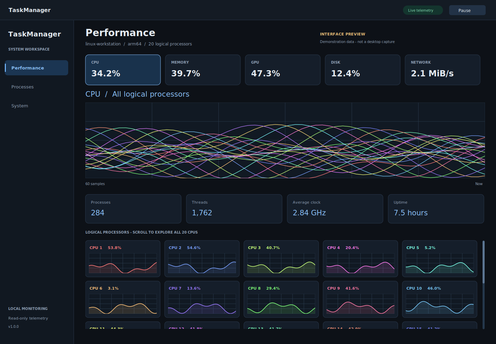
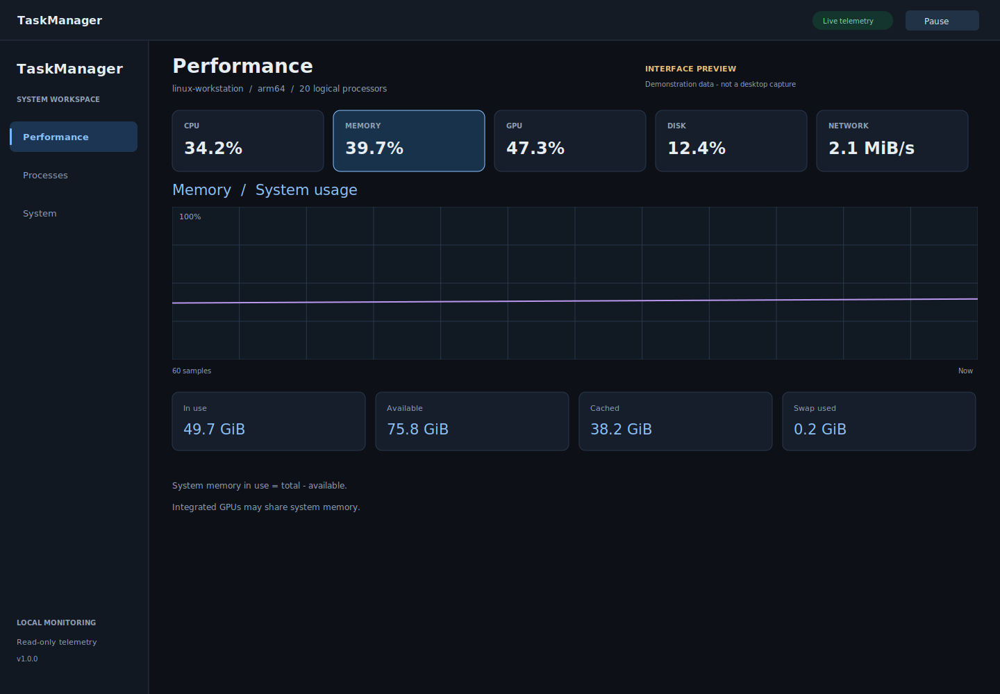
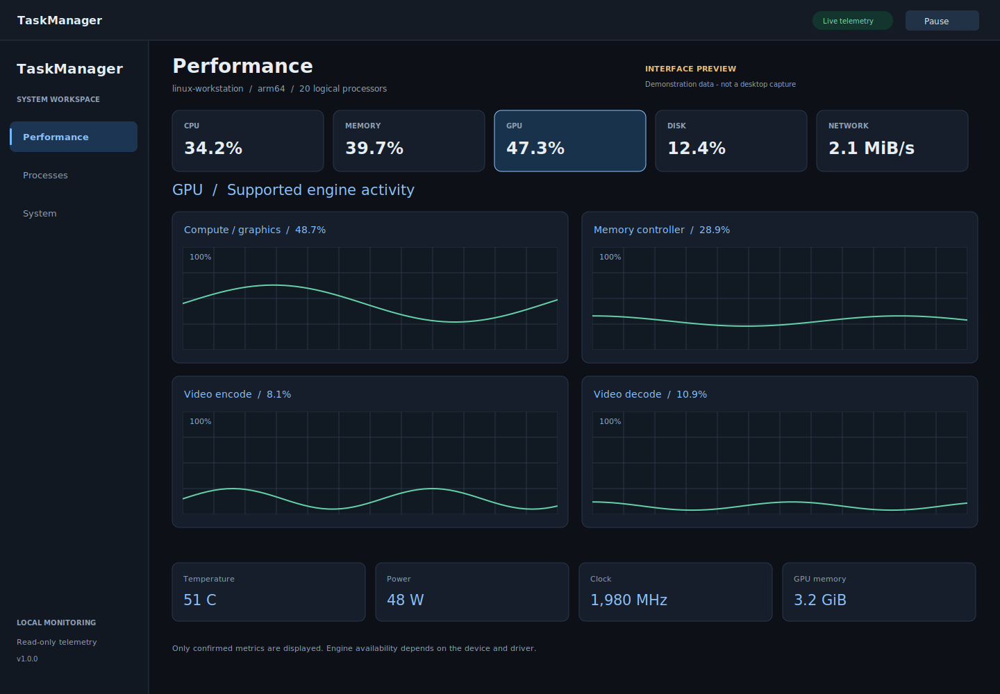
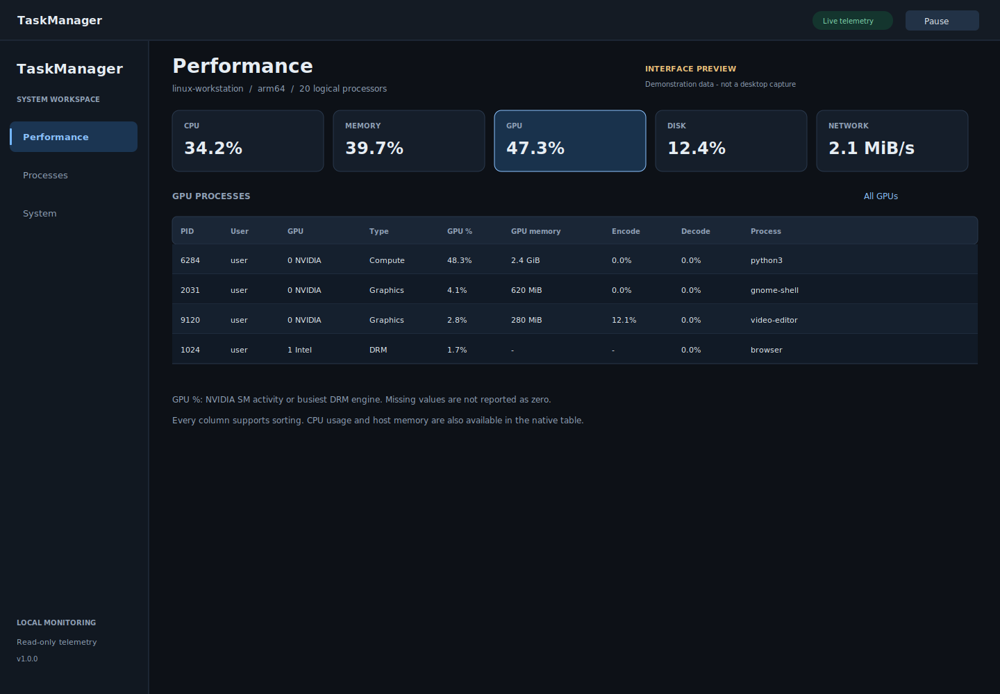
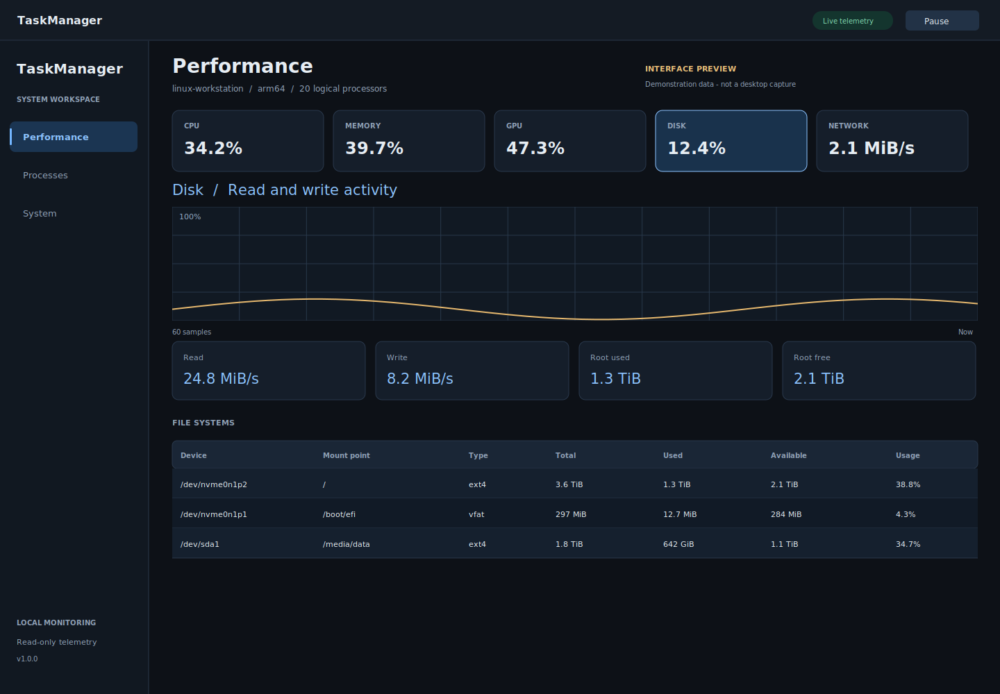
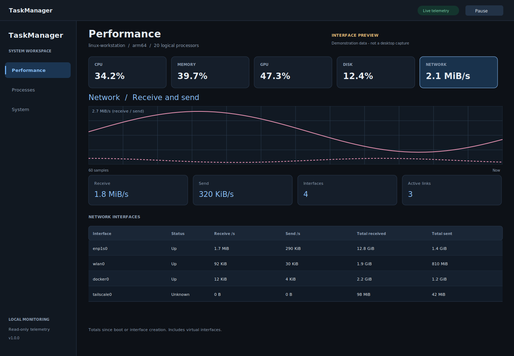
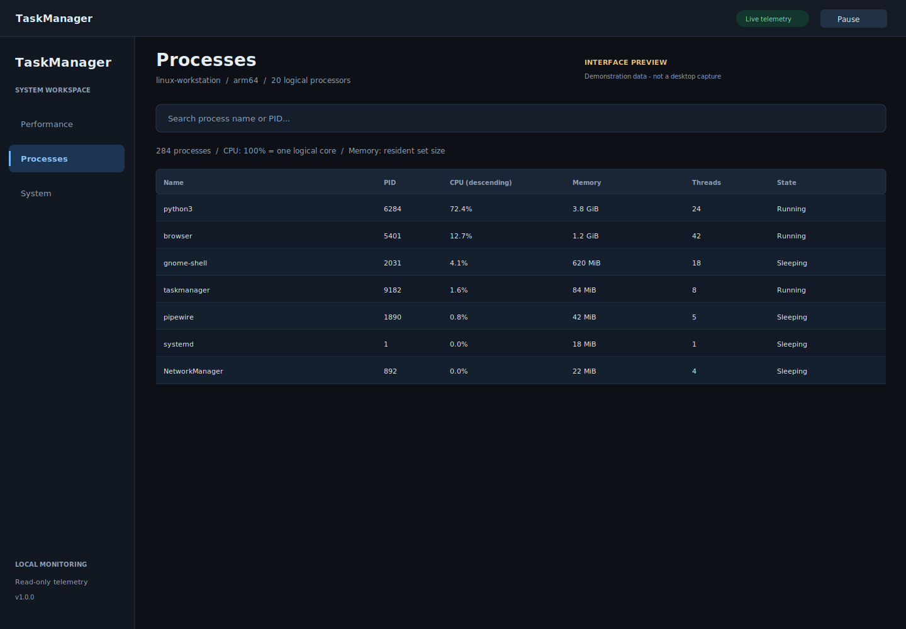
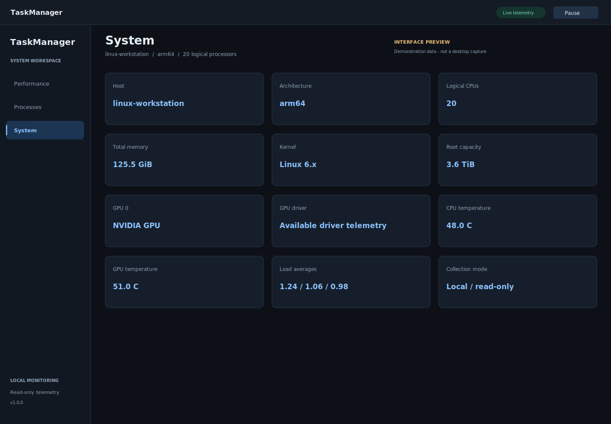

<div align="center">


# TaskManager

**A clear view of your Linux system.**

A native desktop performance monitor for CPU, memory, GPU, storage, network, and running processes. Built with GTK4 and Python, with live charts and an nvtop-style GPU process table.

[](#requirements)
[](#requirements)
[](#features)
[](LICENSE)

[Install](#install) · [Run](#run) · [Gallery](#gallery) · [Hardware support](#hardware-support) · [Troubleshooting](#troubleshooting)

</div>



> The images currently shown are **labelled interface illustrations with demonstration data**, not native desktop screenshots. The layout and readings in a running installation can differ. The [capture command](#capture-native-screenshots) saves eight real screenshots from the actual GTK application.

## Features

| Workspace | What you can inspect |
| --- | --- |
| **CPU** | Total utilization, color-coded histories for every logical processor, individual per-core charts with a dedicated scrollbar, average clock, load averages, uptime, process and thread counts. |
| **Memory** | System memory use, available memory, cache, and swap. |
| **GPU** | Device selection, utilization, temperature, power, clock, memory, and supported engine histories. Metrics appear automatically when the driver confirms a valid reading. |
| **GPU processes** | PID, user, GPU, workload type, GPU/engine activity, GPU memory, encode/decode activity, CPU use, host RAM, and process name with application icons. Show all GPUs or the selected device. |
| **Disk** | Physical device read/write throughput and active time, plus mounted file systems with capacity, available space, and usage bars. |
| **Network** | Receive/send histories and an interface table with link status, rates, and cumulative traffic. |
| **Processes** | Search by name or PID, application icons, CPU and resident memory, thread counts, and process states. |
| **System** | Host, architecture, kernel, memory, storage, GPU driver, and available thermal sensors. |

All **30 table columns** support ascending and descending sorting. Byte counts, rates, percentages, PIDs, and thread counts sort numerically, and the selected order remains active during live updates.

TaskManager collects read-only local telemetry. It does not run a web server, install a background service, or need administrator privileges to monitor your machine. The interface uses Cairo software rendering so that displaying GPU metrics does not depend on access to a GPU render device.

## Requirements

- Linux with a graphical desktop, on **x86-64** or **ARM64**.
- System Python **3.10 or newer**.
- GTK4, PyGObject, Pycairo, and the Cairo GI bridge.
- Optional: a functioning NVIDIA driver and `nvidia-smi` for NVIDIA management telemetry.

Ubuntu/Debian dependencies, if they are not already present:

```bash
sudo apt install python3-gi python3-cairo python3-gi-cairo gir1.2-gtk-4.0
```

This is a one-time system dependency step. **Installing TaskManager itself is per-user and does not use sudo.** Windows and macOS are not supported by the current collectors.

## Install

```bash
git clone https://github.com/PuChan-HCI/TaskManager.git
cd TaskManager
/usr/bin/python3 install-user.py
```

The installer copies the application into `~/.local/share/taskmanager`, creates `~/.local/bin/taskmanager`, and adds **TaskManager** to your applications menu. The menu entry uses an absolute launcher path, so it works even if `~/.local/bin` is not on `PATH`.

Upgrading from the earlier **Spark Task Manager** installation? Run this installer from the updated source folder. It migrates the known application files and menu entry to the new name. The launch command becomes `taskmanager`.

To use another installation location:

```bash
/usr/bin/python3 install-user.py --prefix /your/install/path
```

## Run

Open **TaskManager** from your applications menu, or run:

```bash
~/.local/bin/taskmanager
```

If `~/.local/bin` is on your `PATH`, you can use `taskmanager` directly.

To run from the source folder without installing:

```bash
/usr/bin/python3 native.py
```

Use the system Python rather than a Conda environment that may not provide GTK bindings. Close and reopen the application after updating it.

### Keyboard shortcuts

| Shortcut | Action |
| --- | --- |
| `Ctrl+F` | Open Processes and focus the search field |
| `Ctrl+P` | Pause or resume live updates |
| `Ctrl+Q` | Quit |

## Gallery

The following eight images are interface previews, each explicitly marked as demonstration data. Native captures can be generated with the command below.

### CPU: from total load to individual cores


Switch between all-CPU history and total utilization. Scroll the per-core area independently to inspect larger machines.

### Memory: usage and availability



See in-use, available, cached, and swap memory at a glance. Shared system memory is treated separately from discrete GPU memory when the driver reports it.

### GPU: supported engines and sensors



GPU engine panels appear only after valid readings are received. Supported engines at 0% remain visible; missing data is not presented as idle activity.

### GPU processes: an nvtop-style view



Inspect individual workloads with sortable process details. The native table also exposes CPU use and host RAM through horizontal scrolling.

### Disk: I/O and file systems



Pair physical disk activity with filesystem capacity and usage. The file systems table refreshes independently of CPU and network sampling.

### Network: rates and interface totals



Inspect receive/send activity alongside per-interface link state and cumulative traffic.

### Processes: search and sort



Application icons make the process list easier to scan. Click any column header to change the sort order.

### System: hardware and operating system details



A compact grid brings together platform information and available thermal sensors.

### Capture native screenshots

From a terminal in your **graphical desktop session**, run:

```bash
cd TaskManager
/usr/bin/python3 capture_screenshots.py
```

This opens the real application, visits each workspace, saves **eight PNG screenshots** into `docs/screenshots`, and exits. It uses the GTK widget tree and the active renderer; it does not generate mock windows. Captures contain live machine data. Use `--output /your/folder` to choose another directory.

The current preview illustrations can be regenerated independently with:

```bash
/usr/bin/python3 docs/render_previews.py
```

## Hardware support

| Hardware | Telemetry backend | Notes |
| --- | --- | --- |
| Intel/AMD CPUs, ARM64 systems | Linux `/proc` and `/sys` | Vendor-independent CPU, memory, disk, network, process, and filesystem collection. |
| NVIDIA RTX and other supported NVIDIA GPUs, DGX Spark | `nvidia-smi` XML and optional `pmon` | Management metrics, supported media engines, process identities/memory, and per-process activity where available. |
| AMD GPUs | DRM/sysfs and hwmon | GPU/memory activity, VRAM, and available temperature, power, and clock readings. |
| Intel GPUs and compatible DRM drivers | Readable DRM client `fdinfo` counters | Render/3D, copy, compute, and media activity where the driver exports matching counters. |
| Multiple GPUs | Device discovery and GPU selector | Each discovered GPU has its own recent history. The process table can show all devices together. |

**Engine names are not interchangeable.** Combined NVIDIA GPU/SM activity is not substituted for a separate 3D or Copy counter. A render engine may execute both graphics and compute. TaskManager shows separate engine charts only when corresponding driver data can be read.

DRM client charts cover **readable processes only**. Protected processes belonging to other users may be excluded. Duplicate/shared client descriptors are deduplicated for aggregate charts. Grouped counters account for engine capacity, and multiple instances of a class show the busiest instance. Shared client activity or memory can still appear in more than one process row and should not be added together.

Supported drivers and hardware vary. The Intel/AMD/NVIDIA parser paths have been tested with controlled telemetry fixtures; physical validation so far is limited to the current ARM64 Spark environment. The application's CPU, memory, disk, and network views remain usable when GPU telemetry is unavailable.

References: [NVIDIA telemetry](https://docs.nvidia.com/deploy/nvidia-smi/), [Linux DRM client statistics](https://www.kernel.org/doc/html/latest/gpu/drm-usage-stats.html), [AMD monitoring interfaces](https://kernel.org/doc/html/latest/gpu/amdgpu/thermal.html).

## Reading the metrics

- **CPU:** process CPU uses 100% per logical processor, so multithreaded processes can exceed 100%. Per-core charts use a fixed 0–100% scale.
- **Memory:** system in-use memory is total minus available. Process memory is RSS and includes shared pages. Host RAM and GPU memory are different measurements.
- **GPU processes:** GPU activity is NVIDIA SM activity or the busiest reported DRM engine. Missing values are shown as `—`.
- **Disk:** active time is the percentage of time a device was busy, not its capacity usage. Filesystem available space excludes reserved blocks; usage is used / (used + available).
- **Network:** totals include virtual interfaces and may count the same traffic at several layers. Counters run since boot or interface creation.
- **Refresh:** core telemetry updates every second, filesystems every five seconds, and GPU queries run with a three-second interval plus query time. Management queries may take longer when they wait or time out.
- **History:** the application retains up to 60 display samples. Pause freezes the interface while background collection continues.

## Update

```bash
cd TaskManager
git pull --ff-only
/usr/bin/python3 install-user.py
```

Then close and reopen TaskManager.

## Uninstall

```bash
/usr/bin/python3 ~/.local/share/taskmanager/install-user.py --uninstall
```

For an alternate installation prefix, pass the same `--prefix` used during installation.

## Troubleshooting

**`No module named gi` or `cairo`:** use `/usr/bin/python3` and install the listed system dependencies. A Conda Python can have a separate package search path.

**No graphical display:** launch from a Linux desktop terminal. The GUI and native screenshot capture require a graphical session. The headless self-test does not.

**GPU detected, but no utilization:** the kernel can identify a device without exposing monitoring counters. Check the installed driver. For NVIDIA, run `nvidia-smi`. TaskManager retries automatically and does not modify drivers or device permissions.

**Empty GPU process table:** the GPU may be idle, process monitoring may be unsupported, or access may be restricted. Missing values remain `—`.

**Command not found:** run `~/.local/bin/taskmanager`, or add `~/.local/bin` to your shell's `PATH`.

**Old application still visible:** close the previous application and run the new installer. It removes recognized per-user files from the old Spark Task Manager installation.

## Development

The core application has two modules:

- `native.py`: GTK4 interface, charts, icons, sortable tables, and UI actions.
- `metrics.py`: Linux counters, file systems, NVIDIA management telemetry, and DRM GPU/client collection.

The installer, desktop entry, and SVG icon provide per-user desktop integration. Documentation images and capture utilities live alongside the source; no generated package or browser dashboard is required.

Run the headless check with:

```bash
/usr/bin/python3 native.py --self-test
```

It exercises live collection, chart rendering, GPU parser cases, and native numeric sorting. A working graphical session is still required to validate native layout and interaction.

## License

[MIT](LICENSE) · Copyright © 2026 PuChan.
